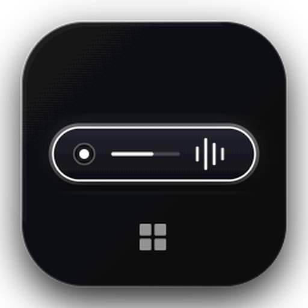

# 🪟 Windows Dynamic Notch

<p align="center">
  
</p>

<p align="center">
  <strong>Dynamic Island & Mac Notch Experience for Windows 10 & 11</strong><br />
  Aplikasi desktop melayang (overlay) modern dengan estetika Glassmorphism ultra-smooth yang menghadirkan pengalaman Dynamic Island macOS langsung ke layar Windows Anda.
</p>

<p align="center">
  
  
  
  
  
</p>

---

## ✨ Fitur Utama

### 1. 🏝️ Dynamic Island Pill & Multi-Mode
- **Island Jam & Tanggal (Default)**: Pill minimalis elegan yang menampilkan live digital clock (`HH:mm:ss`) beserta tanggal, indikator baterai, dan status sistem.
- **Mini Player Switcher**: Klik ikon musik pada pill untuk beralih antara tampilan jam dan mini music controller tanpa membuka menu besar.
- **Minimal Strip**: Mode garis tipis ultra-ringan yang tersembunyi manis di atas bezel monitor.
- **Mascot Mode**: Animasi mata interaktif yang merespons status audio yang sedang diputar.

### 2. 🎛️ Hardware HUD (Otomatis Muncul)
- **Volume & Mute Overlay**: Notifikasi visual meluncur dari notch saat volume master Windows dinaikkan atau diturunkan.
- **CapsLock Indicator**: Menampilkan status CapsLock ON/OFF secara otomatis dan instan dari notch, bahkan saat notch sedang tersembunyi (*auto-hidden*).

### 3. 🚀 Expanded Hub (Pusat Produktivitas Terpadu)
Arahkan kursor atau klik notch untuk membuka hub lengkap dengan tab navigasi:
- 🎵 **Musik & Live Lyrics**: Kontrol media Windows SMTC (Spotify, YouTube, browser, media player) lengkap dengan seekbar, volume slider, dan panel sinkronisasi lirik berjalan.
- 🍅 **Produktivitas & Fokus**:
  - **Pomodoro Timer**: Presets 25/5, 50/10, atau custom dengan audio chime lembut saat sesi selesai.
  - **Water Reminder**: Pelacak hidrasi harian dengan quick add (+250ml, +500ml) dan progress bar.
  - **To-Do List**: Checklist tugas harian cepat yang tersimpan secara lokal.
- 🕌 **Jadwal Sholat & Countdown**:
  - Penanda waktu sholat harian terintegrasi otomatis.
  - **Highlight Ganda**: Hijau emerald untuk waktu saat ini dan oranye amber dengan countdown live menuju waktu sholat berikutnya.
- ⚡ **System Monitor**: Pemantau performa perangkat keras real-time (beban CPU %, penggunaan RAM, kecepatan unduh/unggah jaringan).
- 📁 **File Shelf**: Rak file sementara berbasis drag & drop untuk menyimpan file penting saat multitasking.

### 4. 🎯 Smart Dwell & Click-Through Cerdas
- **Anti-Accident Dwell Trigger (120ms)**: Notch tidak akan terbuka secara tidak sengaja saat kursor hanya melintas sekilas di atas tab browser.
- **Dynamic OS Window Bounds**: Jendela Electron otomatis menyesuaikan ukuran aslinya (*bounds*) mengikuti mode:
  - Mode Jam: hanya 280 x 48 px.
  - Mode Expanded: membesar dinamis (490 x 215–350 px).
  - Mode Tersembunyi: hanya 180 x 8 px.
  - **Hasil**: Area di bawah dan di samping notch 100% tembus klik (*native click-through*) ke tab browser dan aplikasi di belakangnya tanpa ada area transparan yang memblokir.
- **Garis Indikator Penanda (*Home Bar Indicator*)**: Garis tipis transparan (64px x 3px) di tepi atas monitor yang memberi petunjuk posisi notch saat sedang *auto-hide*. Garis akan membesar dan bersinar lembut saat kursor didekatkan.
- **Fullscreen Auto-Detection**: Notch otomatis menyembunyikan diri saat Anda menonton video YouTube full screen atau bermain game agar tidak menutupi tampilan.

---

## 🛠️ Arsitektur & Teknologi

| Komponen | Teknologi | Keterangan |
| :--- | :--- | :--- |
| **Desktop Runtime** | [Tauri v2](https://tauri.app/) (Rust) | Frameless, transparent, ultra-ringan (~25-40MB RAM), native WebView2. |
| **Frontend UI** | [React 19](https://react.dev/) + [Vite](https://vitejs.dev/) | Reactivity tinggi dengan HMR super cepat dan Lucide Icons. |
| **Styling** | Vanilla CSS Glassmorphism | Backdrop-filter blur 24px, spring physics cubic-bezier, dan border glow halus. |
| **Windows Integration** | Native Win32 & WinRT Rust | Deteksi hardware event instan (Core Audio Master Volume, CapsLock hook, WinRT SMTC media session). |
| **Audio Notification** | Web Audio API Oscillator | Chime pengingat lembut sintetis tanpa memerlukan aset file audio eksternal. |

---

## 🚀 Memulai (Getting Started)

### Prasyarat
- Sistem Operasi: **Windows 10 / 11** (64-bit)
- **Node.js**: versi 18.x atau lebih baru
- **npm**: versi 9.x atau lebih baru

### Instalasi

1. **Clone repository ini**:
   ```bash
   git clone https://github.com/username/notch-for-windows.git
   cd notch-for-windows
   ```

2. **Install dependensi**:
   ```bash
   npm install
   ```

3. **Jalankan dalam mode pengembangan**:
   ```bash
   npm run dev
   ```
   *Perintah ini akan menjalankan Vite dev server dan meluncurkan jendela Electron overlay di atas layar desktop Anda.*

4. **Build untuk produksi**:
   ```bash
   npm run build
   ```

---

## 📁 Struktur Direktori

```text
notch-for-windows/
├── src-tauri/
│   ├── src/lib.rs            # Rust backend (Win32 Core Audio, WinRT SMTC, CapsLock, Tray)
│   ├── tauri.conf.json       # Konfigurasi window Tauri (transparan, frameless, bounds)
│   └── Cargo.toml            # Dependensi Rust (sysinfo, windows crate)
├── src/
│   ├── components/
│   │   ├── IdlePill.jsx      # Compact island pill (Clock & Mini-Player)
│   │   ├── ExpandedHub.jsx   # Expanded container dengan tab navigasi
│   │   ├── HardwareHUD.jsx   # HUD volume & capslock pop-up
│   │   ├── PomodoroTimer.jsx # Focus timer
│   │   ├── WaterReminder.jsx # Hydration tracker
│   │   ├── TodoList.jsx      # Task checklist
│   │   ├── PrayerTimes.jsx   # Jadwal sholat & dual highlight
│   │   ├── SystemMonitor.jsx # Telemetri sistem
│   │   ├── FileShelf.jsx     # Quick drag & drop storage
│   │   └── SettingsPanel.jsx # Pengaturan preferensi notch
│   ├── App.jsx               # Main controller, state management, & hover logic
│   ├── index.css             # Glassmorphism styling, transitions, & responsive states
│   └── main.jsx              # React DOM entrypoint
├── package.json
└── README.md
```

---

## ⚙️ Pengaturan & Kustomisasi

Buka **Settings Panel** lewat Expanded Hub (klik ikon roda gigi ⚙️) untuk menyesuaikan:
- **Tampilan Default**: Pilih antara Mode Jam (*Default*), Mascot, atau Minimal Strip.
- **Perilaku Auto-Hide**: Nyalakan atau matikan mode auto-hide otomatis.
- **Sembunyikan saat Fullscreen**: Otomatis sembunyikan notch saat aplikasi/game berjalan layar penuh.
- **Selalu di Atas (Always on Top)**: Pastikan notch selalu melayang di atas jendela aplikasi lain.
- **Buka saat Windows Menyala (Start at Login)**: Otomatis menjalankan notch saat booting.
- **Suara Chime**: Aktifkan atau nonaktifkan audio reminder untuk Pomodoro dan Jadwal Sholat.

---

## 💡 Pintasan & Tips Penggunaan

- **Membuka Notch**: Sentuh tepi tengah atas layar monitor (pada garis penanda).
- **Pin Notch**: Klik ikon Pin 📌 pada header expanded agar notch tetap terbuka saat bekerja.
- **Ganti Mode Jam / Musik**: Klik ikon 🎵 di sebelah kiri pill jam untuk melihat lagu yang sedang diputar.
- **Keluar Aplikasi**: Klik kanan ikon Notch di **System Tray Windows** (dekat jam taskbar) lalu pilih **Keluar**, atau melalui menu pengaturan di notch.

---

## 📄 Lisensi

Proyek ini dilisensikan di bawah lisensi [ISC License](LICENSE).
Dikembangkan untuk menghadirkan pengalaman desktop Windows yang lebih elegan, produktif, dan menyenangkan.
