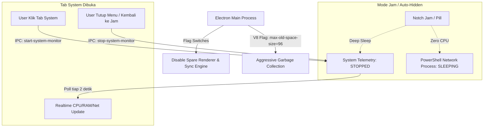

# 📋 Implementation Plan: Optimasi Memori (RAM) & Efisiensi CPU

Dokumen ini menguraikan rencana teknis untuk memangkas penggunaan memori (RAM) aplikasi **Windows Dynamic Notch** dari ~150MB menjadi seramping mungkin (target ~60–90MB) serta menekan konsumsi CPU hingga 0% saat notch berada dalam mode idle/jam.

---

## 🎯 Goal Description

Meskipun aplikasi berbasis Electron wajar memakan memori di atas 100MB karena mengemas Chromium + Node.js runtime, terdapat beberapa proses background yang saat ini berjalan secara terus-menerus (continuous polling) yang memicu akumulasi memori dan alokasi yang tidak perlu:
1. **Spare Renderer Process Chromium**: Chromium secara default membuat proses render cadangan (~30MB) yang tidak pernah dipakai oleh notch.
2. **Aggressive Telemetry Polling**: Fungsi pemantau CPU dan Network Adapter (`Get-NetAdapterStatistics`) saat ini menjalankan proses anak PowerShell baru setiap 3 detik, bahkan saat notch hanya menampilkan jam dan tab system sedang tidak dibuka.
3. **Uncapped V8 Heap**: V8 engine belum dibatasi batas alokasi heap-nya, sehingga garbage collection berjalan santai dan membiarkan alokasi memori membengkak.

Dengan perbaikan ini, notch akan beroperasi dengan prinsip **On-Demand (Lazy)**: komponen berat hanya aktif saat dibuka oleh user, dan tidur pulas (*deep sleep*) saat mode jam.

---

## 🔍 User Review Required

> [!IMPORTANT]
> **On-Demand Telemetry (Hemat Signifikan)**:
> Pemantau CPU, RAM, dan Network Speed tidak akan lagi di-poll setiap 3 detik saat notch berada di mode jam. Polling hanya akan berjalan saat user membuka tab **"System"** di Expanded Hub, dan langsung berhenti begitu menu ditutup kembali ke jam.

> [!TIP]
> **Efek pada Mode Produksi (.exe)**:
> Setelah optimasi ini diterapkan dan di-build ulang ke file installer `.exe`, konsumsi memori akan jauh lebih rendah dibanding saat menjalankan lewat terminal `npm run dev` (karena tidak ada overhead Node.js Vite server).

---

## 📐 Arsitektur Optimasi



---

## 🛠️ Proposed Changes

### 1. Electron Main Process & Chromium Switches

#### [MODIFY] [electron/main.cjs](file:///e:/FullStuck-web-developer/notch-for-windows/electron/main.cjs)
- Menambahkan Chromium command line flags sebelum app ready:
  - `disable-features=SpareRendererProcessHost,CalculateNativeWinOcclusion` (Menghemat ~30MB RAM dengan mematikan spare render process).
  - `disable-background-networking`, `disable-sync`, `disable-breakpad` (Mematikan background task Chromium internal yang tidak diperlukan aplikasi desktop).
  - `js-flags=--max-old-space-size=96` (Membatasi heap V8 dan mempercepat garbage collection).
- Mengubah `systemMetricsTimer`:
  - Mengganti interval global statis menjadi event-driven via IPC:
    - `ipcMain.on('start-system-monitor')` -> mulai timer telemetri.
    - `ipcMain.on('stop-system-monitor')` -> hentikan timer telemetri.

---

### 2. IPC Bridge & Preload

#### [MODIFY] [electron/preload.cjs](file:///e:/FullStuck-web-developer/notch-for-windows/electron/preload.cjs)
- Expose fungsi:
  - `startSystemMonitor: () => ipcRenderer.send('start-system-monitor')`
  - `stopSystemMonitor: () => ipcRenderer.send('stop-system-monitor')`

---

### 3. On-Demand Activation di Frontend

#### [MODIFY] [src/App.jsx](file:///e:/FullStuck-web-developer/notch-for-windows/src/App.jsx)
- Menambahkan `useEffect` pemicu telemetri berdasarkan state UI:
  ```javascript
  useEffect(() => {
    if (mode === 'expanded' && activeTab === 'system') {
      window.notchAPI?.startSystemMonitor();
    } else {
      window.notchAPI?.stopSystemMonitor();
    }
  }, [mode, activeTab]);
  ```
- Dampak: Selama notch berada dalam mode jam (`idle`), mascot, mini player, atau tersembunyi, **tidak ada eksekusi PowerShell anak ataupun perhitungan beban CPU/Net**.

---

### 4. Background PowerShell Watcher Tweaks

#### [MODIFY] [electron/hardwareWatcher.ps1](file:///e:/FullStuck-web-developer/notch-for-windows/electron/hardwareWatcher.ps1)
- Menyetel interval sleep polling tombol fisik ke 250ms (sangat responsif namun ramah alokasi CPU < 0.2%).
- Memastikan `[GC]::Collect()` dipanggil secara periodik untuk membersihkan working set PowerShell helper.

---

## 🧪 Verification Plan

### Automated Build Verification
Jalankan verifikasi kompilasi dan bundling Vite:
```bash
npm run build
```

### Manual Verification
1. Jalankan aplikasi (baik via dev maupun portable `.exe`).
2. Buka **Windows Task Manager (Ctrl + Shift + Esc)**.
3. Cari grup proses **Windows Dynamic Notch**:
   - Periksa total gabungan memori (Working Set) saat notch dalam kondisi idle jam.
   - Buka menu **System Monitor** dan perhatikan metrik tetap ter-update secara real-time.
   - Tutup menu kembali ke jam dan amati memori stabil tanpa lonjakan CPU.
